# SAF — Super Agent Framework

[](https://github.com/Bellero-Advanced/super-agent-framework/actions/workflows/ci.yml)
[](https://www.npmjs.com/package/super-agent-framework)
[](LICENSE)

**SAF makes Claude Code prove its work: no "done" without a real run, a reviewer who is not the builder, and a plan of
small cards that big work cannot drift from.**

[ภาษาไทย](README.th.md)



<sub>Every line above is real output, recorded from a fresh project by [`scripts/demo.mjs`](scripts/demo.mjs). The
builder's first try had a failing test and touched a file outside its card, so the engine refused to call it done.</sub>

## Quickstart (30 seconds)

```bash
cd your-project            # new or existing, any language
npx create-saf             # copies the engine (tools/saf/) and the setup skill
claude                     # then type: /saf-setup
```

`/saf-setup` asks a few grouped questions (each with a recommended answer), generates everything, runs the first card,
and has the designer draft your first milestone — then waits for your Go.

Without npm's `create` step: `npx github:Bellero-Advanced/super-agent-framework init`. Without questions:
`npx create-saf --answers answers.json` ([docs/install.md](docs/install.md)).

## How it works

```
             ┌──────────── milestone M1 (owner said Go) ────────────┐
 designer ──▶│ card T-M1-01   card T-M1-02   card T-M1-03 …          │  each card: the files it may touch,
 writes      └──────┬───────────────┬──────────────────────────────┘  the commands that prove it, scenarios
 cards              ▼               ▼
            task:start          task:start --worktree  ◀── parallel lanes: own git worktree, own port
                │                   │                       (+ side lanes for cards of the next milestone)
           implementer          implementer
                │                   │
           task:verify ──✗──▶ not done: failing command, file outside the card, scenario without a test
                │ ✓  evidence JSON: commit, every command, exit code, output, changed files
          spec-reviewer (read only, never the builder)  ·  qa-runner (real runs)
                │
          commit / task:merge (one at a time, re-checked, rolled back if it breaks)
                ▼
          task:verify M1 ── exit gates ──▶ report ──▶ owner closes the milestone
```

- **Roles** with fixed models and effort: `designer` and `spec-reviewer` plan and judge; `implementer` and `qa-runner`
  build and test — plus optional roles (release, security, database, art, data, content) and your own
- **Gates** per milestone: commands that must pass plus manual checks, recorded as evidence
- **Test mode**: choose how often the full test suite runs (every card, targeted, or once at the milestone gate — the
  default); `task:culprit` finds the card that broke the suite
- **Lanes**: independent cards run side by side in worktrees; `task:next --parallel` tells you which are safe together
- **A SessionStart hook** tells every new session the milestone, the card in progress and its criteria — so it does not
  start from zero or wander off the plan

## Why not plain Claude Code?

| Plain Claude Code | With SAF |
|---|---|
| "Done!" — you find out later whether it runs | `task:verify` runs the card's commands; only a pass is recorded as done, with the output kept as evidence |
| The model that wrote the code also judges it | `spec-reviewer` is a separate, read-only role that checks the code against the spec |
| A long task slowly drifts from what you asked | Work is cut into small cards; edits outside a card's files fail verify; milestones have exit gates |
| Each new session forgets where you were | The hook injects the current milestone, card and criteria at every start |
| Parallel agents step on each other | Worktree lanes with their own ports and test databases; merges go one at a time with checks |
| Rules live in one long prompt | Generated `CLAUDE.md`, path rules, roles and skills — checked by `docs:check` so they stay true |

The engine is plain Node (≥ 20) with **zero dependencies**, vendored into your repo at `tools/saf/`, and works with npm,
pnpm, yarn, bun or no package manager. Linux, macOS and Windows are tested in CI.

## What you get

- `/saf <anything>` — one entry point that routes your request (build through a card, plan, bug, tests, security,
  question); `/saf-plan` for planning and `/saf-setup` to change settings
- **Skills** loaded when the work matches: debug protocol, TDD, code review, security review, test runner,
  evidence-before-done, handoff, writing for agents — plus optional packs (UI, database migrations, performance, i18n,
  mobile, game)
- **Guards**: `docs:check` (agent docs stay true), `check-secrets`, `spec:matrix` (every scenario ↔ a test), a measure
  lock that queues heavy test runs

See a real project taken through two milestones: [examples/todo-api](examples/todo-api).

## Documentation

| Topic | Doc |
|---|---|
| Install, non-interactive setup, adopting an existing project | [docs/install.md](docs/install.md) |
| Every setup question and the config key it sets | [docs/setup-questions.md](docs/setup-questions.md) |
| Cards, milestones, lanes, side lanes, evidence | [docs/card-lifecycle.md](docs/card-lifecycle.md) |
| Agent roles | [docs/roles.md](docs/roles.md) |
| Skills and skill packs | [docs/skills.md](docs/skills.md) |
| Model presets | [docs/model-presets.md](docs/model-presets.md) |
| `saf.config.json` reference | [docs/config-reference.md](docs/config-reference.md) |
| Upgrading | [docs/upgrade.md](docs/upgrade.md) |
| FAQ | [docs/faq.md](docs/faq.md) |
| Contributing · security · roadmap · changes | [CONTRIBUTING.md](CONTRIBUTING.md) · [SECURITY.md](SECURITY.md) · [ROADMAP.md](ROADMAP.md) · [CHANGELOG.md](CHANGELOG.md) |

## License

[MIT](LICENSE)
