# SAF — Super Agent Framework

[](https://github.com/Bellero-Advanced/super-agent-framework/actions/workflows/ci.yml)
[](https://www.npmjs.com/package/super-agent-framework)
[](LICENSE)

**SAF ทำให้ Claude Code ต้องพิสูจน์งาน: ไม่มีคำว่า "เสร็จ" ถ้าไม่มีผลรันจริง · คนตรวจไม่ใช่คนทำ · งานใหญ่เดินตามแผนการ์ดเล็กๆ
ไม่หลุดทาง**

[English](README.md)



<sub>ทุกบรรทัดข้างบนเป็นผลรันจริงจากโปรเจคใหม่ บันทึกโดย [`scripts/demo.mjs`](scripts/demo.mjs) · รอบแรกคนทำมี test ที่ล้ม
และแก้ไฟล์นอกการ์ด เครื่องมือจึงไม่ยอมนับว่าเสร็จ</sub>

## เริ่มใน 30 วินาที

```bash
cd your-project            # โปรเจคใหม่หรือที่มีอยู่แล้ว ภาษาอะไรก็ได้
npx create-saf             # คัดลอกเครื่องมือ (tools/saf/) และ skill ตั้งค่า
claude                     # แล้วพิมพ์: /saf-setup
```

`/saf-setup` ถามคุณเป็นกลุ่มสั้นๆ (ทุกข้อมีค่าแนะนำ) สร้างทุกอย่าง รันการ์ดแรก แล้วให้ designer ร่าง milestone แรก และหยุดรอคุณกด Go

ไม่ใช้ `create` ของ npm: `npx github:Bellero-Advanced/super-agent-framework init` · ไม่ต้องตอบคำถาม:
`npx create-saf --answers answers.json` ([docs/install.md](docs/install.md))

## ทำงานยังไง

```
             ┌──────────── milestone M1 (คุณกด Go แล้ว) ─────────────┐
 designer ──▶│ การ์ด T-M1-01   การ์ด T-M1-02   การ์ด T-M1-03 …        │  การ์ดแต่ละใบ: ไฟล์ที่แตะได้
 เขียนการ์ด  └──────┬────────────────┬───────────────────────────────┘  คำสั่งที่พิสูจน์ · ฉากยอมรับ
                    ▼                ▼
            task:start          task:start --worktree  ◀── สายขนาน: worktree และพอร์ตของตัวเอง
                │                   │                       (+ สายข้าง สำหรับการ์ดของ milestone ถัดไป)
           implementer          implementer
                │                   │
           task:verify ──✗──▶ ไม่เสร็จ: คำสั่งล้ม · แก้ไฟล์นอกการ์ด · ฉากยอมรับไม่มี test
                │ ✓  หลักฐาน JSON: commit · ทุกคำสั่ง · exit code · ผลลัพธ์ · ไฟล์ที่เปลี่ยน
          spec-reviewer (อ่านอย่างเดียว ไม่ใช่คนทำ)  ·  qa-runner (รันของจริง)
                │
          commit / task:merge (รวมทีละใบ ตรวจซ้ำ ย้อนเองถ้าพัง)
                ▼
          task:verify M1 ── ประตูออก ──▶ รายงาน ──▶ คุณปิด milestone
```

- **บทบาท** พร้อมโมเดลและ effort ตายตัว: `designer` กับ `spec-reviewer` วางแผนและตัดสิน · `implementer` กับ `qa-runner`
  สร้างและทดสอบ — มีบทบาทเสริม (release · security · database · ภาพ · data · เนื้อหา) และบทบาทของคุณเอง
- **ประตู** ของแต่ละ milestone: คำสั่งที่ต้องผ่าน + ข้อที่คนตรวจเอง บันทึกเป็นหลักฐาน
- **โหมดทดสอบ**: เลือกได้ว่ารัน test ทั้งชุดบ่อยแค่ไหน (ทุกการ์ด · เฉพาะที่แตะ · หรือครั้งเดียวที่ประตู milestone ซึ่งเป็นค่าเริ่มต้น) · `task:culprit` หาการ์ดที่ทำให้ชุด test ล้ม
 การ์ดที่ไม่ทับกันทำพร้อมกันใน worktree · `task:next --parallel` บอกชุดที่ปลอดภัย
- **hook SessionStart** บอก session ใหม่ทุกครั้งว่า milestone ไหน การ์ดไหน เกณฑ์ผ่านคืออะไร — ไม่เริ่มจากศูนย์ ไม่หลุดแผน

## ต่างจาก Claude Code เปล่าๆ ยังไง

| Claude Code เปล่าๆ | ใช้ SAF |
|---|---|
| "เสร็จแล้ว!" — แล้วค่อยมารู้ทีหลังว่ารันได้ไหม | `task:verify` รันคำสั่งของการ์ด ผ่านเท่านั้นจึงนับว่าเสร็จ และเก็บผลรันเป็นหลักฐาน |
| โมเดลที่เขียนโค้ดเป็นคนตัดสินงานตัวเอง | `spec-reviewer` เป็นอีกบทบาท อ่านอย่างเดียว เทียบโค้ดกับสเปก |
| งานยาวค่อยๆ หลุดจากที่ขอ | ตัดงานเป็นการ์ดเล็ก · แก้ไฟล์นอกการ์ด = verify ไม่ผ่าน · milestone มีประตูออก |
| session ใหม่ลืมว่าทำถึงไหน | hook ฉีด milestone การ์ด และเกณฑ์ผ่านให้ทุกครั้งที่เริ่ม |
| agent หลายตัวทำพร้อมกันแล้วชนกัน | สายใน worktree แยกพอร์ตและฐาน test · รวมทีละใบพร้อมตรวจ |
| กฎอยู่ใน prompt ยาวๆ ก้อนเดียว | `CLAUDE.md` กฎตาม path บทบาท และ skill ที่สร้างให้ — `docs:check` ตรวจให้ตรงความจริงเสมอ |

ตัวเครื่องมือเป็น Node ล้วน (≥ 20) **ไม่มี dependency** คัดลอกไว้ใน repo ของคุณที่ `tools/saf/` ใช้ได้กับ npm · pnpm · yarn ·
bun หรือไม่มี package manager · ทดสอบบน Linux · macOS · Windows ใน CI

## ได้อะไร

- `/saf <อะไรก็ได้>` — ทางเข้าเดียว ส่งคำขอให้ถูกทาง (สร้างผ่านการ์ด · วางแผน · บั๊ก · ทดสอบ · ความปลอดภัย · คำถาม) ·
  `/saf-plan` วางแผน · `/saf-setup` เปลี่ยนการตั้งค่า
- **skill** ที่โหลดเองเมื่องานตรง: หาบั๊กแบบมีหลักฐาน · TDD · ตรวจโค้ด · ตรวจความปลอดภัย · รัน test · หลักฐานก่อนบอกเสร็จ ·
  ส่งต่องาน · เขียนเอกสารให้ agent — และชุดเสริม (UI · migration ฐานข้อมูล · ประสิทธิภาพ · หลายภาษา · มือถือ · เกม)
- **ตัวกัน**: `docs:check` · `check-secrets` · `spec:matrix` (ทุกฉากยอมรับ ↔ test) · กุญแจวัดผลต่อคิวคำสั่งหนัก

ดูโปรเจคจริงที่ผ่านสอง milestone: [examples/todo-api](examples/todo-api)

## เอกสาร

เอกสารของตัว framework เป็นภาษาอังกฤษ ([ตาราง](README.md#documentation)) ส่วนเอกสารที่ SAF สร้างในโปรเจคเป็นภาษาที่คุณเลือก
(ไทยได้ทั้งหมด) · [การ์ดและสาย](docs/card-lifecycle.md) · [คำถามตั้งค่า](docs/setup-questions.md) ·
[skill](docs/skills.md) · [ร่วมพัฒนา](CONTRIBUTING.md) · [แผนต่อไป](ROADMAP.md)

## สัญญาอนุญาต

[MIT](LICENSE)
